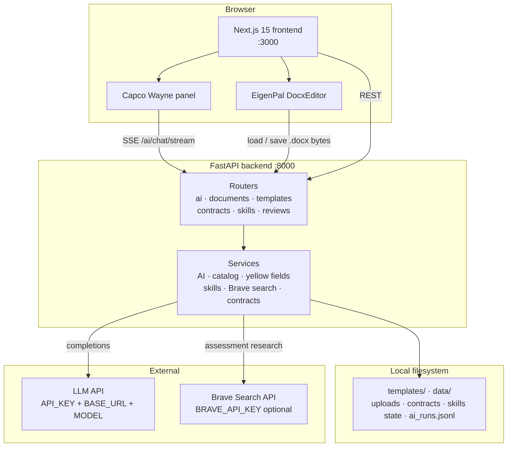
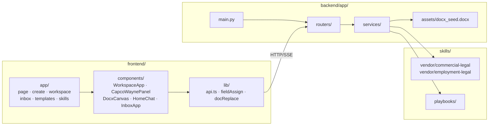
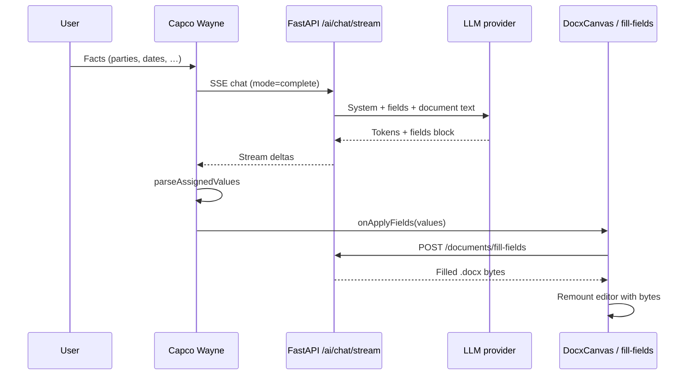
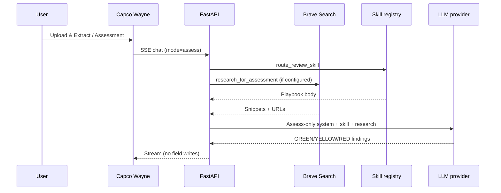
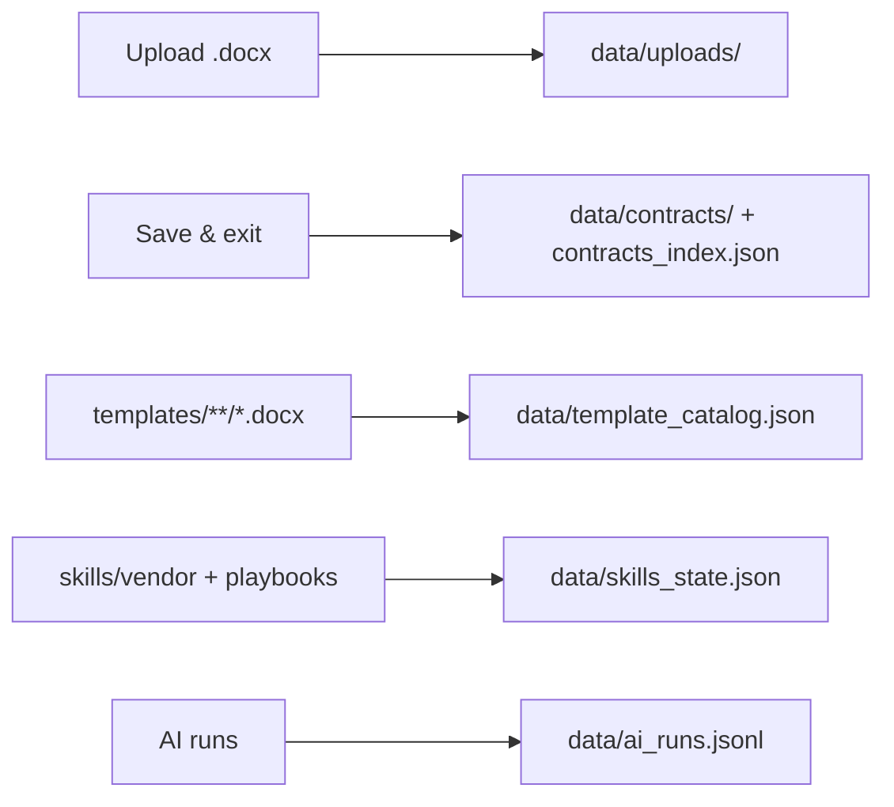

# Capco Contract Assists

Chat-first corporate contract workspace for Capco / Wipro legal operations. Capco Wayne is the in-product copilot: complete yellow Word fields live in [EigenPal docx-editor](https://github.com/eigenpal/docx-editor), run skills-based assessments, and research market norms via Brave Search.

Visual language follows [Capco Wealth & Asset Management](https://www.capco.com/Industries/wealth-and-asset-management): black architectural surfaces, Baskerville display type, clean sans UI.

**Repo:** [github.com/alanyoungcy/legalassits](https://github.com/alanyoungcy/legalassits)

---

## Contents

- [Features](#features)
- [Architecture](#architecture)
- [Components](#components)
- [Data flow](#data-flow)
- [Installation](#installation)
- [Configure](#configure)
- [Run](#run)
- [Templates & skills](#templates--skills)
- [API surface](#api-surface)
- [Security notes](#security-notes)

---

## Features

| Area | What it does |
| --- | --- |
| **Create** | Blank Word workspace; Capco Wayne offers Templates / Upload / AI draft |
| **Complete fields** | Streaming chat assigns yellow Variables into the live `.docx` |
| **Assessment** | Skills playbook + optional Brave web research; document stays unchanged |
| **Upload & Extract** | Single-file upload → original preserved → auto skills assessment |
| **Inbox** | Save & exit drafts; reopen from Inbox |
| **Templates** | Browse / upload / manage `.docx` templates with AI blank discovery |
| **Skills** | Enable Capco commercial & employment review skills from `claude-for-legal` |

---

## Architecture

Local stack: **Next.js frontend + FastAPI backend + filesystem** (`templates/`, `data/`). No container runtime required.



Future-oriented product notes (not wired into this runtime): [`docs/LEGAL_CONTRACT_COMPLIANCE_DESIGN.md`](docs/LEGAL_CONTRACT_COMPLIANCE_DESIGN.md), [`docs/AUTONOMOUS_LEGAL_ENTERPRISE_PRACTICES.md`](docs/AUTONOMOUS_LEGAL_ENTERPRISE_PRACTICES.md).

---

## Components



| Layer | Key pieces |
| --- | --- |
| **UI** | `WorkspaceApp`, `DocxCanvas`, `CapcoWaynePanel`, `InboxApp` |
| **API** | FastAPI under `/api/v1` |
| **AI** | `services/ai.py` — `complete` vs `assess`, skill routing, SSE |
| **Search** | `services/web_search.py` — Brave Web Search for Assessment |
| **Docs** | `documents.py`, `yellow_fields.py`, `field_discovery.py`, `docx_package.py` |
| **Catalog** | Template index on disk + upload with AI blank highlighting |
| **Contracts** | Inbox drafts via `POST /contracts/from-workspace` |

---

## Data flow

### Complete yellow fields



### Assessment (document unchanged)



### Persistence



---

## Installation

### Prerequisites

- **Python 3.11+**
- **Node.js 20+** (22 OK) and npm

### 1. Clone

```bash
git clone https://github.com/alanyoungcy/legalassits.git
cd legalassits
```

### 2. Environment

```bash
cp .env.example .env
```

Edit `.env` — set at least `API_KEY` (and optionally `BRAVE_API_KEY`). **Never commit `.env`.**

### 3. Backend

```bash
cd backend
python3.11 -m venv .venv
.venv/bin/pip install -r requirements.txt
cd ..
```

### 4. Frontend

```bash
cd frontend
npm install
cd ..
```

### 5. Start

```bash
./scripts/dev.sh start
```

| Service | URL |
| --- | --- |
| App | http://localhost:3000 |
| API health | http://localhost:8000/healthz |
| OpenAPI | http://localhost:8000/docs |

Stop: `./scripts/dev.sh stop` · Status: `./scripts/dev.sh status`

---

## Configure

| Variable | Required | Purpose |
| --- | --- | --- |
| `API_KEY` | Yes (for Wayne) | LLM provider API key |
| `BASE_URL` | No | OpenAI-compatible base URL |
| `MODEL` | No | Model id (default `gpt-4o-mini`) |
| `COPILOT_NAME` | No | Display name, e.g. `"Capco Wayne"` |
| `BRAVE_API_KEY` | No | Assessment web research |
| `NEXT_PUBLIC_API_BASE_URL` | No | Frontend → API (`http://localhost:8000`) |
| `CORS_ORIGINS` | No | Allowed browser origins |

---

## Run

### Recommended: `dev.sh`

```bash
./scripts/dev.sh start
./scripts/dev.sh status
./scripts/dev.sh stop
./scripts/dev.sh restart
```

### Manual

```bash
# Terminal A — API
cd backend
.venv/bin/uvicorn app.main:app --host 127.0.0.1 --port 8000

# Terminal B — Web
cd frontend
npm run dev -- --port 3000
```

---

## Templates & skills

### Yellow fields

Drop `.docx` files under `templates/` (folders allowed). Yellow-highlighted text becomes Variables:

| In Word | Field key |
| --- | --- |
| `[Party Name]` | `party_name` |
| `{{effective_date}}` | `effective_date` |
| `[[CONFIDENTIALITY_TERM]]` | `confidentiality_term` |

Optional sidecar: `my-template.meta.json` next to the `.docx`.

Reindex:

```bash
curl -X POST http://127.0.0.1:8000/api/v1/templates/reindex
```

### Skills

Vendored from [anthropics/claude-for-legal](https://github.com/anthropics/claude-for-legal) (Apache-2.0):

- `skills/vendor/commercial-legal` — NDA / MSA / SaaS / vendor review
- `skills/vendor/employment-legal` — hiring, termination, classification, …

Manage enablement at `/skills`. Capco stubs: `skills/playbooks/`.

---

## API surface

| Prefix | Role |
| --- | --- |
| `/api/v1/ai` | SSE stream chat, status |
| `/api/v1/documents` | Upload, fill-fields, workspace docx |
| `/api/v1/templates` | Catalog, upload, CRUD |
| `/api/v1/contracts` | Drafts / Inbox (`from-workspace`) |
| `/api/v1/skills` | List / toggle / reindex |
| `/api/v1/reviews` | Skill-guided review runs |

---

## Security notes

- **Do not commit** `.env`, API keys, Brave tokens, or client documents under `data/`.
- `.gitignore` excludes `.env`, uploads, contracts, catalogs, and `data/ai_runs.jsonl`.
- Rotate any key that was pasted into chat, tickets, or screenshots.
- Assessment mode must not mutate the Word document; completion mode writes Variables only after structured `fields` blocks.

---

## License & attribution

- Application code: Capco Contract Assists (project local).
- Review skills: Apache-2.0 via Anthropic `claude-for-legal`.
- Editor: EigenPal `docx-editor` packages.
